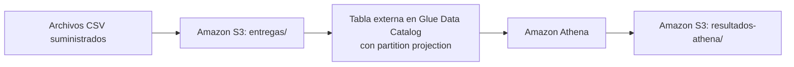

# Punto 1 — Partition projection con S3, Glue Data Catalog y Athena

Una empresa de mensajería recibe un archivo diario con los intentos de entrega. Los archivos quedan en S3 y se consultan desde Athena por medio de una tabla externa del Glue Data Catalog que usa **partition projection** por `fecha`. Así, un día nuevo se puede consultar con solo subir su archivo: no hace falta ejecutar un crawler ni registrar particiones.



## Contenido

| Ruta | Descripción |
| --- | --- |
| `infraestructura/principal.tf` | Proveedor AWS, bucket privado, base y tabla de Glue con partition projection, workgroup de Athena |
| `infraestructura/variables.tf` | Región, nombres y rango de fechas proyectado |
| `infraestructura/salidas.tf` | Outputs: bucket, rutas, base de datos, tabla, plantilla de ubicación y workgroup |
| `consultas/` | SQL de la demostración inicial y de la verificación del tercer día |
| `scripts/ejecutar_athena.py` | Ejecuta una consulta en el workgroup, guarda el resultado y lo registra en `evidencias/ejecuciones_athena.csv` |
| `resultados/inicial/`, `resultados/final/` | Resultados obtenidos en Athena, por etapa |
| `repo_punto1/DE-Final-Entregas/resultados_esperados/` | Referencias suministradas por el docente (no se suben a S3) |
| `repo_punto1/DE-Final-Entregas/data/entregas/` | Archivos de entrada suministrados, sin modificar |
| `evidencias/` | Salidas de Terraform, outputs, cargas, particiones de Glue, ejecuciones de Athena y eliminación |
| `respuestas.md` | Respuestas a las preguntas conceptuales |

## Recursos creados con Terraform

| Recurso | Nombre | Detalle |
| --- | --- | --- |
| Bucket S3 | `fp-examen-p1-entregas-<cuenta>` | Privado, con los cuatro bloqueos de acceso público. Prefijos `entregas/` (datos) y `resultados-athena/` (Athena) |
| Base de datos de Glue | `examen_entregas` | |
| Tabla externa | `examen_entregas.entregas` | CSV con `LazySimpleSerDe`, separador `,`, `skip.header.line.count = 1`. Columnas `id_envio string`, `ciudad string`, `transportadora string`, `estado string`, `duracion_minutos int`. Clave de partición `fecha string` |
| Workgroup de Athena | `fp-examen-p1-wg` | Resultados en `s3://<bucket>/resultados-athena/`, configuración obligatoria para todas las consultas |

Propiedades de proyección de la tabla:

| Propiedad | Valor |
| --- | --- |
| `projection.enabled` | `true` |
| `projection.fecha.type` | `date` |
| `projection.fecha.format` | `yyyy-MM-dd` |
| `projection.fecha.range` | `2026-10-01,2026-10-03` |
| `projection.fecha.interval` | `1` |
| `projection.fecha.interval.unit` | `DAYS` |
| `storage.location.template` | `s3://<bucket>/entregas/fecha=${fecha}/` |

En `principal.tf` la plantilla se escribe con `$${fecha}`. El doble `$` evita que Terraform lo interprete como una de sus variables, y en AWS queda `${fecha}`, que Athena reemplaza en cada consulta. La plantilla apunta al prefijo de la partición y termina en `/`. El archivo `entregas.csv` está dentro de ese prefijo.

El bucket y el workgroup tienen `force_destroy = true`. Así `terraform destroy` puede eliminarlos aunque contengan objetos o historial de consultas.

## Prerrequisitos

| Herramienta | Versión usada |
| --- | --- |
| Terraform | ≥ 1.5, proveedor `hashicorp/aws ~> 6.0` |
| AWS CLI | v2 |
| Python | 3.x con `boto3` |
| Sistema | Ubuntu sobre WSL2 |

- Usuario de IAM `user_cli` configurado en la AWS CLI, con permisos sobre S3, Glue y Athena.
- Región `us-east-2` (Ohio).

```bash
aws configure                 # o export AWS_PROFILE=<perfil>
aws sts get-caller-identity   # comprueba la identidad
pip install boto3             # si no está instalado
```

Todos los comandos se ejecutan desde la raíz del repositorio.

## 1. Despliegue

```bash
terraform -chdir=infraestructura init
terraform -chdir=infraestructura fmt -check
terraform -chdir=infraestructura validate
terraform -chdir=infraestructura plan          # 5 to add, 0 to change, 0 to destroy

terraform -chdir=infraestructura apply -auto-approve -no-color 2>&1 | tee evidencias/aplicacion_terraform.txt
terraform -chdir=infraestructura output -json > evidencias/outputs.json

BUCKET=$(terraform -chdir=infraestructura output -raw bucket)
BASE=$(terraform -chdir=infraestructura output -raw base_datos)
TABLA=$(terraform -chdir=infraestructura output -raw tabla)
```

Para dejar evidencia de la definición de la tabla en el catálogo:

```bash
aws glue get-table --database-name "$BASE" --name "$TABLA" \
  --query "Table.{Nombre:Name,Tipo:TableType,Columnas:StorageDescriptor.Columns,Particion:PartitionKeys,Ubicacion:StorageDescriptor.Location,Parametros:Parameters}" \
  > evidencias/tabla_glue.json
```

## 2. Demostración inicial: días 1 y 2

Se suben **solo** los dos primeros archivos, uno por uno, desde la consola de S3 (región Ohio). No se sube la carpeta completa.

1. En el bucket, **Create folder** `entregas` y dentro de ella **Create folder** `fecha=2026-10-01`.
2. Dentro de `entregas/fecha=2026-10-01/`: **Upload** → **Add files** → `repo_punto1/DE-Final-Entregas/data/entregas/fecha=2026-10-01/entregas.csv` → **Upload**.
3. Lo mismo para `fecha=2026-10-02` con su archivo.

Las carpetas creadas desde la consola son objetos vacíos de 0 bytes y no aportan filas. Comprobación:

```bash
aws s3 ls "s3://$BUCKET/entregas/" --recursive | tee evidencias/carga_inicial.txt
```

En este momento la tabla tiene 12 registros. El 2026-10-03 ya está en el rango proyectado, pero todavía no tiene archivo, así que no aporta filas ni produce errores.

Consultas iniciales:

```bash
python3 scripts/ejecutar_athena.py --etapa inicial \
  --sql consultas/intentos_por_fecha_estado.sql \
  --resultado resultados/inicial/intentos_por_fecha_estado.csv \
  --esperado repo_punto1/DE-Final-Entregas/resultados_esperados/intentos_por_fecha_estado_inicial.csv

python3 scripts/ejecutar_athena.py --etapa inicial \
  --sql consultas/porcentaje_exito_por_fecha_ciudad.sql \
  --resultado resultados/inicial/porcentaje_exito_por_fecha_ciudad.csv \
  --esperado repo_punto1/DE-Final-Entregas/resultados_esperados/porcentaje_exito_por_fecha_ciudad_inicial.csv

python3 scripts/ejecutar_athena.py --etapa inicial \
  --sql consultas/duracion_promedio_2026-10-02.sql \
  --resultado resultados/inicial/duracion_promedio_2026-10-02.csv \
  --esperado repo_punto1/DE-Final-Entregas/resultados_esperados/duracion_promedio_2026-10-02.csv
```

En cada ejecución, `ejecutar_athena.py`:

1. Lee el workgroup, la base y la región de `evidencias/outputs.json`.
2. Ejecuta el SQL en el workgroup `fp-examen-p1-wg`.
3. Descarga el CSV que Athena escribe en `resultados-athena/<id>.csv` y lo guarda sin comillas, porque Athena pone todos los valores entre comillas y las referencias no las tienen.
4. Registra la ejecución en `evidencias/ejecuciones_athena.csv`, con las columnas `etapa`, `archivo_sql`, `id_ejecucion` y `archivo_resultado`.
5. Compara el resultado con la referencia.

Además, cada ejecución queda anotada en `evidencias/bitacora_athena.txt`, con su estado y los bytes escaneados.

Resultado: las tres consultas coinciden con sus referencias. Las consultas sin filtro de fecha escanearon 626 bytes, que son los dos archivos de 313 bytes. La del 2 de octubre escaneó 313, porque Athena leyó solo la partición de ese día.

Decisiones en el SQL:

- Las consultas de intentos y porcentaje no tienen filtro de fechas. Athena recorre las fechas proyectadas y devuelve solo las que tienen datos, así que el mismo SQL sirve para las dos etapas.
- En el porcentaje, el numerador se convierte a `DOUBLE` para evitar la división entera, y el resultado se convierte a `DECIMAL(5,2)` para conservar siempre dos decimales.
- El promedio filtra `estado = 'entregado'` antes de calcular, para no incluir los ceros de los intentos fallidos.

## 3. Nueva fecha: día 3

No se modifica la infraestructura ni la tabla: no se ejecuta `terraform apply`, crawlers, `MSCK REPAIR TABLE` ni `ALTER TABLE ADD PARTITION`. Solo se sube el archivo y se consulta.

```bash
aws s3 cp "repo_punto1/DE-Final-Entregas/data/entregas/fecha=2026-10-03/entregas.csv" "s3://$BUCKET/entregas/fecha=2026-10-03/entregas.csv"
aws s3 ls "s3://$BUCKET/entregas/" --recursive | tee evidencias/carga_tercer_dia.txt
aws glue get-partitions --database-name "$BASE" --table-name "$TABLA" > evidencias/particiones_glue_final.json
```

`particiones_glue_final.json` muestra `"Partitions": []`: con los tres días cargados no hay ninguna partición registrada en Glue.

Verificación (`consultas/verificacion_tercer_dia.sql` tiene tres sentencias):

```bash
python3 scripts/ejecutar_athena.py --etapa final --sql consultas/verificacion_tercer_dia.sql --consulta 1 \
  --resultado resultados/final/verificacion_tercer_dia.csv
python3 scripts/ejecutar_athena.py --etapa final --sql consultas/verificacion_tercer_dia.sql --consulta 2 \
  --resultado resultados/final/verificacion_estados_tercer_dia.csv
python3 scripts/ejecutar_athena.py --etapa final --sql consultas/verificacion_tercer_dia.sql --consulta 3 \
  --resultado resultados/final/verificacion_total_tabla.csv
```

| Archivo | Qué muestra |
| --- | --- |
| `resultados/final/verificacion_tercer_dia.csv` | Los 6 registros del 2026-10-03, con el objeto de S3 del que salió cada uno (`$path`) |
| `resultados/final/verificacion_estados_tercer_dia.csv` | Conteos por estado del 2026-10-03: `destinatario_ausente` 3, `direccion_incorrecta` 1, `entregado` 2 |
| `resultados/final/verificacion_total_tabla.csv` | 18 registros en total, 6 del tercer día, 3 fechas con datos |

Las consultas agregadas se ejecutan de nuevo, sin cambios en el SQL:

```bash
python3 scripts/ejecutar_athena.py --etapa final \
  --sql consultas/intentos_por_fecha_estado.sql \
  --resultado resultados/final/intentos_por_fecha_estado.csv \
  --esperado repo_punto1/DE-Final-Entregas/resultados_esperados/intentos_por_fecha_estado_final.csv

python3 scripts/ejecutar_athena.py --etapa final \
  --sql consultas/porcentaje_exito_por_fecha_ciudad.sql \
  --resultado resultados/final/porcentaje_exito_por_fecha_ciudad.csv \
  --esperado repo_punto1/DE-Final-Entregas/resultados_esperados/porcentaje_exito_por_fecha_ciudad_final.csv
```

Resultado: 18 registros en total, 6 del 2026-10-03 y 3 fechas con datos. La consulta del total escaneó 949 bytes, la suma de los tres archivos (313 + 313 + 323). Las dos consultas agregadas coinciden con las referencias finales.

El promedio solicitado sigue siendo el del 2 de octubre y tiene la misma referencia, por eso no se vuelve a ejecutar.

## 4. Limpieza

Primero se guardan todas las evidencias. Después se vacía el bucket (datos y resultados de Athena) y se eliminan los recursos con Terraform:

```bash
aws s3 rm "s3://$BUCKET" --recursive
terraform -chdir=infraestructura destroy -auto-approve -no-color 2>&1 | tee evidencias/eliminacion_terraform.txt

{
  echo; echo "===== Comprobación posterior ====="
  aws s3api head-bucket --bucket "$BUCKET" 2>&1 || true
  aws glue get-database --name "$BASE" 2>&1 || true
  aws athena get-work-group --work-group fp-examen-p1-wg --region us-east-2 2>&1 || true
} | tee -a evidencias/eliminacion_terraform.txt
```

Las tres comprobaciones deben responder que el recurso no existe (`Not Found`, `EntityNotFoundException`, `InvalidRequestException`).

## 5. Publicación

El ID de la cuenta aparece en el nombre del bucket. Antes de publicar, se enmascara en las evidencias y los resultados:

```bash
CUENTA=$(aws sts get-caller-identity --query Account --output text)
grep -rl "$CUENTA" evidencias resultados | xargs -r sed -i "s/$CUENTA/XXXXXXXXXXXX/g"
git status   # no deben aparecer terraform.tfstate, .terraform/ ni credenciales
```

El `.gitignore` excluye los archivos de estado de Terraform, la carpeta `.terraform/`, los archivos `*.tfvars` y las credenciales.
