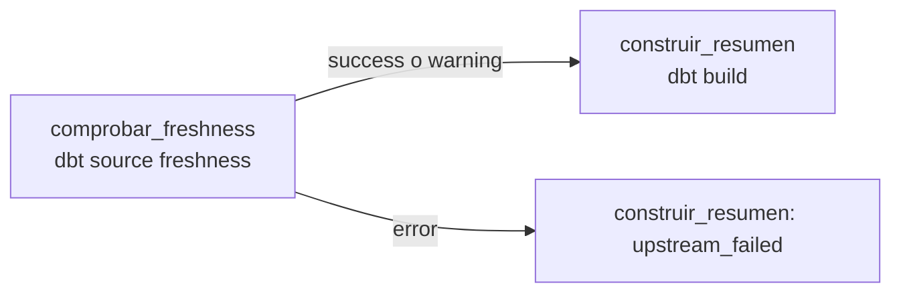

# Punto 2: ventas diarias con control de actualidad

Un pipeline de Airflow, dbt Core 1.9 y DuckDB construye `analytics.ventas_diarias` solo si la fuente `raw.ventas` es suficientemente reciente. La tarea `comprobar_freshness` ejecuta `dbt source freshness` antes de `construir_resumen` (`dbt build`). Si la última carga tiene más de 24 h, la comprobación falla y el build no se ejecuta, así que se conserva el resumen anterior.



## Archivos modificados

Son los únicos tres archivos cambiados del proyecto `DE-Final-Ventas`:

| Archivo | Cambio |
| --- | --- |
| `dbt/models/ventas_diarias.sql` | Agrupa `ref('stg_ventas')` por `fecha_venta`. Calcula `count(*)`, `sum(cantidad)` y `sum(cantidad * precio_unitario)`. El ingreso conserva el tipo `DECIMAL` y no pierde precisión |
| `dbt/models/sources.yml` | En la tabla `ventas`, al mismo nivel y fuera de `config`, como pide la ficha de dbt 1.9: `loaded_at_field: _loaded_at`, `warn_after: {count: 12, period: hour}`, `error_after: {count: 24, period: hour}` |
| `airflow/dags/examen_ventas.py` | Tarea nueva `comprobar_freshness`, que llama a `run_dbt(["source", "freshness"])`, y la dependencia `comprobar_freshness >> construir_resumen`. Mantiene la regla predeterminada `all_success`, sin reintentos y sin `--warn-error` |

| Última carga | Freshness | Salida de dbt | Construcción |
| --- | --- | --- | --- |
| Hasta 12 h | pass | 0 | se ejecuta |
| Más de 12 h y hasta 24 h | warn | 0 | se ejecuta |
| Más de 24 h | error | 1, y `run_dbt` lanza `CalledProcessError` | `upstream_failed` |

## Resultado del modelo

`dbt build`: PASS en 2 modelos y 17 pruebas.

| fecha_venta | numero_ventas | unidades_vendidas | ingreso_total |
| --- | ---: | ---: | ---: |
| 2026-01-10 | 2 | 3 | 46.00 |
| 2026-01-11 | 3 | 6 | 51.25 |
| 2026-01-12 | 1 | 4 | 12.40 |

## Demostración

### 1. Fuente actualizada

```bash
bash scripts/examen.sh scenario actualizada
```

Se lanzó una ejecución manual con **Trigger DAG**. `comprobar_freshness` y `construir_resumen` terminaron en `success`, en ese orden. El último `dbt build` registrado en `run_results.json` es de las 12:36:03 UTC, con todas las pruebas en `pass`.

- Capturas: `capturas/01_actualizada_graph.png`, `capturas/02_actualizada_run_details.png`
- Estado del resumen antes del bloqueo: la consulta del resumen no se guardó en un archivo después de esta ejecución. Lo respalda `run_results.json`, incluido en `evidencias/artifacts_desactualizada.txt`. Ahí el build de las 12:36:03 UTC muestra `model.examen_ventas.ventas_diarias` en `success` y sus 5 pruebas en `pass`, y queda registrado el SQL compilado del modelo. Ese build es el último que se ejecutó.

### 2. Fuente desactualizada

```bash
bash scripts/examen.sh scenario desactualizada   # max_loaded_at = 2026-11-11T06:36:31Z (hace 30 h)
```

Se lanzó una ejecución manual nueva, sin limpiar ni reutilizar la anterior.

| Dato | Valor |
| --- | --- |
| Run ID | `manual__2026-11-12T12:36:49.862097+00:00` |
| Estado del run | `failed` |
| `comprobar_freshness` | `failed`: `dbt source freshness` terminó con código 1 |
| `construir_resumen` | `upstream_failed`, `Trigger Rule all_success`, duración 00:00:00 |
| Motivo (`sources.json`) | `status: error`, `max_loaded_at_time_ago_in_s: 108023` (unas 30,0 h, más que el `error_after` de 24 h) |

**Evidencia de que el build no se ejecutó:**

- **Estado de la tarea:** `construir_resumen` quedó en `upstream_failed`, con duración cero y sin un intento con `INICIO dbt`.
- **`run_results.json`:** el último `dbt build` sigue siendo el de las 12:36:03 UTC. Es anterior a la carga del escenario desactualizado, que fue a las 12:36:31 UTC.
- **El resumen:** después del bloqueo conserva las 3 filas que produce el modelo construido a las 12:36:03 UTC. Por sí solo esto no prueba que el build no corrió, porque los datos de negocio no cambian. Por eso se acompaña con los estados de Airflow.

Archivos de esta ejecución:

- Capturas: `capturas/03_desactualizada_graph.png`, `capturas/04_desactualizada_run_details.png`, `capturas/05_desactualizada_construir_resumen_details.png`, `capturas/06_desactualizada_construir_resumen_logs.png`
- Log del fallo: `evidencias/log_freshness_desactualizada.txt`
- Artefactos dbt: `evidencias/artifacts_desactualizada.txt`
- Resumen después del bloqueo: `evidencias/resumen_despues.txt`

La salida de `dbt source freshness` no aparece en el log de Airflow. `run_dbt` lanza dbt con `subprocess.run`, y la salida de ese proceso hijo no pasa por el logger de la tarea; solo pasan los `print` de `INICIO dbt` y `FIN dbt`. Por eso el motivo del error se toma de `target/sources.json` de esa misma ejecución, generado a las 12:36:54 UTC, mientras la tarea corría entre las 12:36:52 y las 12:36:55.

## Respuestas

Están en [`respuestas.md`](respuestas.md).

## Contenido

```text
entrega_punto2/
├── README.md
├── respuestas.md
├── dbt/models/ventas_diarias.sql
├── dbt/models/sources.yml
├── airflow/dags/examen_ventas.py
├── capturas/
│   ├── 01_actualizada_graph.png
│   ├── 02_actualizada_run_details.png
│   ├── 03_desactualizada_graph.png
│   ├── 04_desactualizada_run_details.png
│   ├── 05_desactualizada_construir_resumen_details.png
│   └── 06_desactualizada_construir_resumen_logs.png
└── evidencias/
    ├── resumen_despues.txt
    ├── artifacts_desactualizada.txt
    └── log_freshness_desactualizada.txt
```

La entrega no incluye imágenes Docker, volúmenes, el archivo `.env` ni credenciales.
